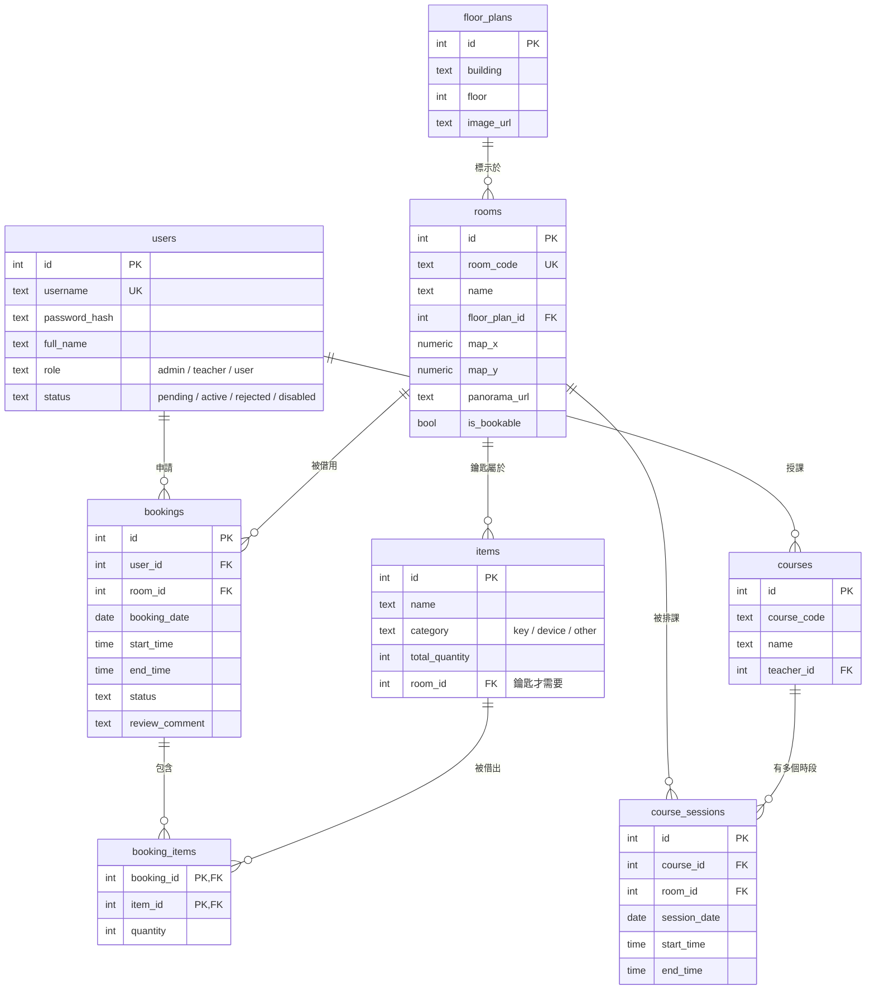

# 資料庫結構設計（PostgreSQL）

> 管院空間查詢／預約借用／排課系統的**共用資料庫**。三個模組共用同一份 schema，修改共用資料表（`users`、`rooms`）前請先在組內討論。

---

## 1. 設計原則（為什麼這樣設計）

三個模組表面上不同，本質上都在回答同一個問題：

> **「誰」在「哪一天的哪個時段」占用了「哪個空間」？**

| 模組 | 誰 | 空間 | 時段 |
|---|---|---|---|
| ① 空間查詢 | —（只是看） | `rooms` | — |
| ② 預約借用 | `users`（借用人） | `rooms` | `bookings` 的日期＋起訖時間 |
| ③ 排課 | `users`（老師） | `rooms` | `course_sessions` 的日期＋起訖時間 |

所以設計時遵守三條規則：

1. **人和空間各只有一張表**（`users`、`rooms`），所有模組都用外鍵（foreign key）指向它們。這樣登入統一、資料也不會重複。
2. **「占用」一律用 `(room_id, 日期, 開始時間, 結束時間)` 表示**。借用和排課用同一種格式，衝突檢查就能共用同一條規則（見第 5 節）。
3. **狀態欄位用 `TEXT` 搭配 `CHECK` 限制**，不用 PostgreSQL 的 `ENUM` 型別。原因是之後想新增狀態時，改 `CHECK` 比改 `ENUM` 簡單得多。

---

## 2. 資料表總覽

| 資料表 | 用途 | 負責模組 |
|---|---|---|
| `users` | 帳號、角色、審核狀態 | **共用** |
| `floor_plans` | 管院各樓層的平面圖 | ① 空間查詢 |
| `rooms` | 教室／空間的基本資料 | **共用**（由 ① 維護） |
| `items` | 可借用的物品（鑰匙、投影筆、筆電…） | ② 預約借用 |
| `bookings` | 預約借用單 | ② 預約借用 |
| `booking_items` | 一張借用單借了哪些物品（多對多） | ② 預約借用 |
| `courses` | 課程本身（課名、授課老師） | ③ 排課 |
| `course_sessions` | 課程的每一次上課時段 | ③ 排課 |
| `room_occupancy`（VIEW） | 把借用和排課合成一份「占用表」 | **整合用** |

---

## 3. ER 圖



---

## 4. 各資料表詳細說明

### 4.1 `users`：帳號（共用）

| 欄位 | 型別 | 說明 |
|---|---|---|
| `id` | `INTEGER` PK | 自動編號 |
| `username` | `VARCHAR(50)` UNIQUE | 登入帳號（例如學號、教職員編號） |
| `password_hash` | `TEXT` | **雜湊過的密碼**，絕對不存明碼 |
| `full_name` | `VARCHAR(50)` | 姓名 |
| `email` | `VARCHAR(100)` | 聯絡信箱 |
| `role` | `TEXT` | `admin` 管理員／`teacher` 老師／`user` 一般使用者 |
| `status` | `TEXT` | `pending` 待審核／`active` 已啟用／`rejected` 退回／`disabled` 停用 |
| `approved_by` | `INTEGER` FK → users | 由哪位管理員審核 |
| `approved_at` | `TIMESTAMPTZ` | 審核時間 |
| `created_at` | `TIMESTAMPTZ` | 註冊時間 |

**帳號狀態流程**：

```
註冊 → pending ──管理員核准──→ active ──停權──→ disabled
                └─管理員退回──→ rejected
```

登入時要檢查兩件事：**密碼正確**，而且 **`status = 'active'`**。

### 4.2 `floor_plans`：樓層平面圖

| 欄位 | 型別 | 說明 |
|---|---|---|
| `id` | `INTEGER` PK | |
| `building` | `VARCHAR(50)` | 館別，例如「管理學院」 |
| `floor` | `SMALLINT` | 樓層，例如 1、2、B1（-1） |
| `image_url` | `TEXT` | 平面圖圖片路徑，例如 `/static/floorplans/1F.png` |

### 4.3 `rooms`：空間（共用，由模組 ① 維護）

| 欄位 | 型別 | 說明 |
|---|---|---|
| `id` | `INTEGER` PK | |
| `room_code` | `VARCHAR(20)` UNIQUE | 空間編號（給人看的，例如 `M101`） |
| `name` | `VARCHAR(100)` | 名稱，例如「電腦教室一」 |
| `room_type` | `TEXT` | `classroom` 教室／`computer_lab` 電腦教室／`meeting` 會議室／`other` |
| `capacity` | `INTEGER` | 容納人數 |
| `equipment` | `TEXT` | 設備說明（投影機、音響…），自由文字 |
| `description` | `TEXT` | 其他說明 |
| `photo_url` | `TEXT` | 一般照片 |
| `panorama_url` | `TEXT` | **360° 全景照片**，給 Pannellum 使用 |
| `floor_plan_id` | `INTEGER` FK → floor_plans | 在哪一張平面圖上 |
| `map_x`, `map_y` | `NUMERIC(5,2)` | 在平面圖上的位置，用**百分比**（0–100） |
| `is_bookable` | `BOOLEAN` | 是否開放借用 |
| `created_at`, `updated_at` | `TIMESTAMPTZ` | |

> **為什麼座標用百分比？** 平面圖在手機和電腦上顯示的大小不同。存百分比的話，`left: 35%; top: 60%` 在任何尺寸下都會指在同一個位置；存像素就會跑掉。

### 4.4 `items`：可借用物品

| 欄位 | 型別 | 說明 |
|---|---|---|
| `id` | `INTEGER` PK | |
| `name` | `VARCHAR(50)` | 例如「投影筆」、「筆電」、「M101 鑰匙」 |
| `category` | `TEXT` | `key` 鑰匙／`device` 設備／`other` |
| `total_quantity` | `INTEGER` | 總數量 |
| `room_id` | `INTEGER` FK → rooms，可為 NULL | **只有鑰匙要填**，表示是哪間教室的鑰匙 |
| `is_active` | `BOOLEAN` | 是否還能借（壞掉、遺失就設成 false） |

### 4.5 `bookings`：預約借用單

| 欄位 | 型別 | 說明 |
|---|---|---|
| `id` | `INTEGER` PK | |
| `user_id` | FK → users | 借用人 |
| `room_id` | FK → rooms | 借用空間 |
| `booking_date` | `DATE` | 借用日期 |
| `start_time`, `end_time` | `TIME` | 時間區間（必須 `start_time < end_time`） |
| `purpose` | `TEXT` | 借用事由 |
| `status` | `TEXT` | 見下方流程 |
| `review_comment` | `TEXT` | **審核意見** |
| `reviewed_by`, `reviewed_at` | | 審核的管理員和時間 |
| `checked_out_by`, `checked_out_at` | | **領用**：哪位管理員、什麼時候登記借出 |
| `returned_by`, `returned_at` | | **歸還**：哪位管理員、什麼時候確認歸還 |
| `created_at` | `TIMESTAMPTZ` | 申請時間 |

**借用單狀態流程**（對應投影片上的「審核 → 領用 → 歸還」）：

```
                    ┌──退件──→ rejected
申請 → pending ─────┤
         │          └──通過──→ approved ──領用──→ checked_out ──歸還──→ returned
         └──申請人取消──→ cancelled
```

> 只有 `approved` 和 `checked_out` 這兩種狀態算「真的占用教室」。`pending` 還沒核准、`rejected` / `cancelled` 已經失效，都不算占用。

### 4.6 `booking_items`：借用單 ↔ 物品（多對多）

| 欄位 | 型別 | 說明 |
|---|---|---|
| `booking_id` | FK → bookings | |
| `item_id` | FK → items | |
| `quantity` | `INTEGER` | 借幾個 |

主鍵是 `(booking_id, item_id)`。

> **為什麼要多一張表？** 一張借用單可以借好幾種物品，一種物品也會出現在很多張借用單上，這是「多對多」關係。如果硬把物品塞進 `bookings` 的一個欄位（例如 `"鑰匙,投影筆"`），之後就很難查「投影筆目前被借走幾支」。拆成獨立的表，每一列只記一件事，查詢就簡單了。

### 4.7 `courses`：課程

| 欄位 | 型別 | 說明 |
|---|---|---|
| `id` | `INTEGER` PK | |
| `course_code` | `VARCHAR(20)` | 課號（可空白） |
| `name` | `VARCHAR(100)` | 課名 |
| `teacher_id` | FK → users | 授課老師。**管理員「指派課程給老師」就是改這個欄位** |
| `created_by` | FK → users | 建立者（老師自己或管理員） |
| `note` | `TEXT` | 備註 |
| `created_at`, `updated_at` | `TIMESTAMPTZ` | |

### 4.8 `course_sessions`：上課時段

| 欄位 | 型別 | 說明 |
|---|---|---|
| `id` | `INTEGER` PK | |
| `course_id` | FK → courses | 屬於哪門課（課程刪除時一併刪除） |
| `room_id` | FK → rooms | **希望的教室** |
| `session_date` | `DATE` | 上課日期 |
| `start_time`, `end_time` | `TIME` | 上課時間區間 |

> **為什麼把「課程」和「時段」拆成兩張表？** 一門課通常一週上一次、一學期上十幾次。課名、老師只需要存一次（`courses`），每一次上課各存一列（`course_sessions`）。
> 這樣**拖拉修改時間**只要更新某一列 `course_sessions` 的日期和時間就好；如果想「整學期一起改」，也只要更新同一個 `course_id` 底下的所有時段。
>
> 新增課程時，畫面可以提供「每週重複 N 週」的選項，後端一次新增 N 列時段。

**權限規則**（在程式裡檢查，不寫在資料庫）：

- 老師只能新增、修改、刪除 `teacher_id = 自己` 的課程
- 管理員可以操作所有課程

---

## 5. 衝突檢查（整合的關鍵）

兩個時段 A、B（同一間教室、同一天）**有重疊**的條件是：

```
A.開始 < B.結束   而且   B.開始 < A.結束
```

用數線想像比較好懂：只有在「A 已經結束 B 才開始」或「B 已經結束 A 才開始」的時候兩者才不重疊；把這兩種情況反過來，就是上面的條件。剛好接在一起（A 10:00 結束、B 10:00 開始）**不算**衝突。

### 5.1 統一占用表 `room_occupancy`（VIEW）

把「已核准的借用」和「排課」合成同一張虛擬表。之後不管是借用頁還是排課頁，只要查這個 VIEW，就能知道某間教室那一週被誰占用。這就是投影片上「**排課與空間借用整合**」的做法。

```sql
SELECT * FROM room_occupancy
WHERE room_id = 3
  AND occupy_date BETWEEN '2026-11-23' AND '2026-11-29'
ORDER BY occupy_date, start_time;
```

### 5.2 新增借用前，檢查是否衝突

```sql
-- 參數：%(room_id)s, %(date)s, %(start)s, %(end)s
SELECT source, title
FROM room_occupancy
WHERE room_id     = %(room_id)s
  AND occupy_date = %(date)s
  AND start_time  < %(end)s     -- 已有的開始 < 新的結束
  AND %(start)s   < end_time;   -- 新的開始 < 已有的結束
-- 查到任何一列 → 有衝突，拒絕新增
```

### 5.3 管理員列出「時間衝突的課程清單」

```sql
SELECT a.id AS session_a, ca.name AS course_a,
       b.id AS session_b, cb.name AS course_b,
       a.session_date, r.room_code,
       CASE WHEN a.room_id = b.room_id THEN '教室衝突' ELSE '老師衝堂' END AS conflict_type
FROM course_sessions a
JOIN course_sessions b
  ON a.id < b.id                              -- 每一對只列一次
 AND a.session_date = b.session_date
 AND a.start_time < b.end_time
 AND b.start_time < a.end_time
JOIN courses ca ON ca.id = a.course_id
JOIN courses cb ON cb.id = b.course_id
JOIN rooms   r  ON r.id  = a.room_id
WHERE a.room_id = b.room_id                   -- 同一間教室
   OR ca.teacher_id = cb.teacher_id           -- 或同一位老師同時上兩門課
ORDER BY a.session_date, a.start_time;
```

> **注意：** 排課**允許**先登記衝突的時段（老師填的是「希望」），由管理員事後列出衝突再調整，所以資料庫**不擋**課程之間的衝突。借用則應該在新增時就用 5.2 檢查並擋下。

---

## 6. 建表 SQL

完整 SQL 在 [`sql/01_schema.sql`](../sql/01_schema.sql)（每行都有註解）。
用 Docker 啟動資料庫時會自動執行，使用方式請看 [`README.md`](../README.md)。

---

## 7. 測試資料

測試資料在 [`sql/02_seed.sql`](../sql/02_seed.sql)。日期都從「本週一」往後推算，所以不論哪天啟動，週曆上都看得到資料。

| 帳號 | 密碼 | 角色 | 狀態 |
|---|---|---|---|
| `admin` | `admin123` | 管理員 | 已啟用 |
| `teacher1` | `teacher1123` | 老師（王老師） | 已啟用 |
| `teacher2` | `teacher2123` | 老師（李老師） | 已啟用 |
| `student1` | `student1123` | 一般使用者 | 已啟用 |
| `student2` | `student2123` | 一般使用者 | 已啟用 |
| `newbie` | `newbie123` | 一般使用者 | **待審核**（測試帳號審核用） |

其他內容：

- **5 個空間**：M101、M102、M201、M202、M203（M203 不開放借用）。編號只是示意。
- **7 項物品**：4 把教室鑰匙、投影筆、筆電、延長線。
- **5 張借用單**：已核准、待審核、已借出、已歸還、被退件各一張，其中兩張借了多項物品。
- **4 門課、10 個上課時段**，裡面**刻意放了兩組衝突**，用來測試衝突清單：
  - 「管理資訊系統」和「程式設計」本週一同時要用 M101 → **教室衝突**
  - 王老師本週一同時要上「管理資訊系統」和「統計學」 → **老師衝堂**

---

## 8. 給程式端的注意事項

1. **密碼雜湊**：統一用 **bcrypt**。測試資料是用 PostgreSQL 的 `crypt(..., gen_salt('bf'))` 產生的 bcrypt 雜湊，Python 端用 `bcrypt` 套件的 `bcrypt.checkpw()` 驗證、`bcrypt.hashpw()` 產生（註冊時用），不要自己寫雜湊。
2. **Session 存什麼**：登入成功後，在 session 存 `user_id` 和 `role` 就夠了，每次需要完整資料再查 `users`。
3. **權限檢查放在後端**：前端隱藏按鈕只是方便，真正的檢查（例如「老師只能改自己的課」）一定要在 FastAPI 的路由裡做。
4. **SQL 一律用參數**（`%s` 或 `%(name)s`），不要用字串拼接，避免 SQL injection。
5. **`updated_at`** 沒有設 trigger，更新資料時請在 SQL 裡手動加 `updated_at = now()`。
6. **連線字串**：`db.py` 從 `.env` 的 `DATABASE_URL` 讀取，不要把密碼寫進程式碼。
